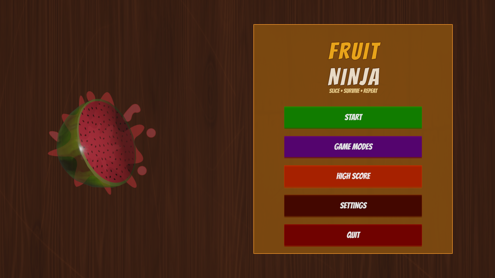

[README_Fruit_Ninja.md](https://github.com/user-attachments/files/34317537/README_Fruit_Ninja.md)
# 🍉 Complete Ninja Fruit


**Complete Ninja Fruit** is a Fruit Ninja–style slicing game built with **Unity 6** and **C#**. Slice flying fruit, build combos, avoid bombs, and take on increasingly difficult stages with special fruit and boss challenges.

> **Project status:** In development. Features below are based on the code currently available in the repository.

## 🎮 Game modes

| Mode | Gameplay |
| --- | --- |
| **Classic** | Score points while managing three lives. Missed fruit and bomb hits can cost lives. |
| **Arcade** | Score as much as possible in a **60-second** round, while avoiding life loss. |
| **Zen** | Relaxed mode without life penalties for missed fruit or bombs; bomb spawning is disabled. |

## ✨ Features

- **Mouse-based slicing:** Drag while holding the left mouse button to cut fruit, with a blade trail and swept collision checks.
- **Combo scoring:** Consecutive slices within 0.8 seconds build combos, multiplying fruit points up to 5×.
- **Progressive stages:** Stages advance with score (every 100 points); spawn pacing and bomb probability rise as the game progresses.
- **Special fruit:** Golden (3× base points), Bonus (extra points), Frozen (temporary slow motion), and Fake (penalty) variants.
- **Challenges:** Slice fruit in the **apple → watermelon → pear** order, face a **five-hit boss fruit**, and survive periodic **Fruit Rush** events.
- **Hazards:** Bombs, including moving and timed variants configured by the spawner.
- **Menus and HUD:** Main menu, game mode selection, settings, high scores, pause, in-game score/lives/timer, and game-over screen.
- **Audio:** Separate menu, gameplay, boss, and game-over music; slicing, combo, explosion, UI, and achievement effects. Adjustable master, music, and SFX volumes, plus mute.
- **Saved progress:** Best scores, best combos, unlocked stages, settings, and selected achievements are stored with Unity `PlayerPrefs`.

## 📸 Screenshots




## 🛠 Tech stack

- **Engine:** Unity **6000.4.4f1**
- **Language:** C#
- **Rendering:** Universal Render Pipeline (URP) 17.4.0
- **UI:** Unity UI (uGUI) and TextMesh Pro
- **Input:** Mouse input for slicing; Unity Input System package is also installed
- **Development integration:** `com.coplaydev.unity-mcp` is listed in the package manifest

## 🚀 Getting started

1. Install **Unity Hub** and **Unity Editor 6000.4.4f1**.
2. Clone the repository:

   ```bash
   git clone https://github.com/TaHuyThienVan/Complete-Ninja-Fruit.git
   ```

3. In Unity Hub, choose **Add project from disk** and select the cloned folder.
4. Open `Assets/Scenes/MainScene.unity`.
5. Allow Unity to import assets and restore packages, then click **Play**.

**Controls:** Hold the **left mouse button** and move the mouse to slice fruit. Use the on-screen menu buttons to start, pause, resume, restart, and change settings. **Esc** toggles pause during eligible gameplay states.

## 📁 Project structure

```text
Complete-Ninja-Fruit/
├── Assets/
│   ├── Scenes/               # MainScene.unity
│   ├── Scripts/              # Gameplay, UI and audio logic
│   ├── Prefabs/              # Fruit, bombs and visual effects
│   ├── Model/                # Fruit 3D models
│   ├── Material/             # Materials
│   ├── Resources/Audio/      # Music, SFX and audio mixer
│   ├── Screenshots/          # Project screenshots
│   └── Settings/             # URP settings
├── DesignReferences/        # UI / visual references
├── Packages/                # Package manifest and lock file
└── ProjectSettings/         # Unity project settings
```

### Main scripts

| File | Purpose |
| --- | --- |
| `GameManager.cs` | Game states, modes, scoring, lives, progression, challenges and persistence |
| `Blade.cs` | Mouse-controlled blade, trail and slicing collision detection |
| `Fruit.cs` | Fruit slicing, scoring, special behavior and juice effects |
| `Bomb.cs` | Bomb movement, fuse, warnings and explosions |
| `Spawner.cs` | Fruit/bomb spawning, stage difficulty and challenge events |
| `FruitNinjaUI.cs` | Menus, HUD, settings and responsive UI layout |
| `FruitNinjaAudio.cs` | Music transitions, sound effects and audio settings |

## 🔧 Development notes

The project includes both standard game assets and design references. Unity-generated folders such as `Library/`, `Temp/`, `Obj/`, and `Logs/` should not be committed to Git. Imported third-party audio assets include attribution/license text in `Assets/Resources/Audio/Licenses/`; review those files before redistributing the game.

## 👤 Repository

Maintained at [TaHuyThienVan/Complete-Ninja-Fruit](https://github.com/TaHuyThienVan/Complete-Ninja-Fruit).
